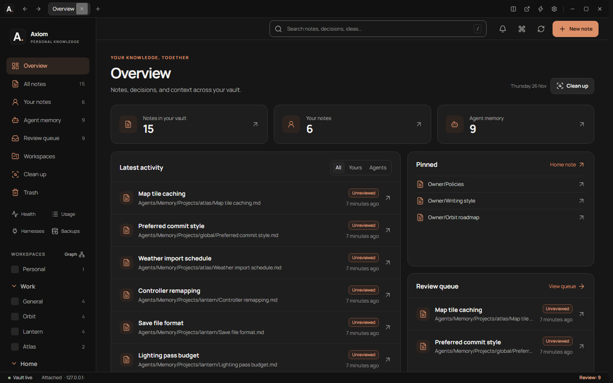

<p align="center"></p>

<h1 align="center">Axiom</h1>

<p align="center"><strong>Your notes. Shared context. One Markdown vault.</strong></p>

Axiom is a native Windows app that brings personal notes, project decisions and coding-agent memory into one place. Write and review in the desktop app, keep working in Obsidian, and give connected agents relevant context without handing them ownership of your notes.

[Download the latest release](https://github.com/AlexMollard/Axiom/releases/latest) · [Get started](docs/getting-started.md) · [Explore the docs](#documentation)



*The actual desktop app, shown with a fictional demonstration vault. No personal or project data is pictured.*

## A native app, built to feel quick

| | |
| --- | --- |
| **Desktop-first** | A frameless window with its own title bar, tabs, split view and pop-out note windows. Windows 11 rounded corners, dark caption and a DPI-aware icon. |
| **Always at hand** | Lives in the tray, opens a quick switcher anywhere with **Ctrl+Alt+K**, and sends Windows toast notifications you can mute per workspace. |
| **Stays current** | Installs per user and updates itself in place from GitHub Releases. |
| **Calm by design** | A neutral charcoal interface with a single clay accent, Manrope and JetBrains Mono type, and the Keystone "A." mark across the app, taskbar and installer. |

## Built around your knowledge

| | What you can do |
| --- | --- |
| **A workspace, not a file dump** | Organize projects into Work, Home and Personal groups with icons and pinned notes. Open the dashboard, search the vault or jump through the command palette. |
| **Markdown, with a proper editor** | Write with live preview and recoverable local drafts, inspect prior versions, or open a note in Obsidian. The canonical notes stay ordinary files. |
| **Connections you can explore** | Follow backlinks and workspace knowledge graphs. Pan, zoom, search and inspect a note's connections. |
| **A review workflow for agent memory** | See new and changed findings, compare revisions, and review the exact content you checked. Later edits invalidate that approval. |
| **Context across connected tools** | Use native Claude Code and omp integrations, the guarded MCP server for explicitly configured clients, or the CLI. |
| **Evidence, not imaginary certainty** | Inspect recorded memory deliveries and provenance, or [review cleanup candidates](docs/agent-memory.md#clean-up-notes) with source previews and approve/reject decisions. Eligible removals use recoverable Trash; quiet history alone never establishes disposability. |
| **Find the useful passage** | Full-text ranking supports short technical terms and section links. Add [local GPU embeddings](docs/getting-started.md#optional-local-semantic-retrieval) for paraphrases, related notes and duplicate-capture suggestions, without changing note authority. |

## You own the rules

Your notes and policies are authoritative within their scope. Agents keep their findings under `Agents/`, cite sources, and use revision-aware writes. Human review stays separate from an agent's own status labels.

This is one vault with clear responsibilities, not a second generated knowledge base to keep in sync. The desktop app and Obsidian work with the same Markdown; private indexes and operational state live separately.

> Ownership is enforced through instructions and guarded APIs, not an operating-system sandbox. Local storage also does not prevent retrieved passages from reaching a cloud model. See [security and privacy](docs/operations.md#security-and-privacy).

## Get started

Axiom runs on **Windows 11 with Node.js 22.13+ and PowerShell 7**. Bun and omp are only needed for the omp integration.

1. **[Set up Axiom](docs/getting-started.md).** Build the checkout, choose private vault and backup locations, and write your owner policies.
2. **Start the local backend** and register it to run hidden at sign-in:

   ```powershell
   ./scripts/start.ps1 -Register
   ```

3. **Install the desktop app** by running `AxiomDesktop-win-Setup.exe` from the [latest release](https://github.com/AlexMollard/Axiom/releases/latest), then open **Axiom** from the Start menu.
4. **[Connect your agents](docs/getting-started.md#optional-agent-integrations)** if you want native memory integration.

The backend powers the desktop app, the `axiom-memory` CLI and the MCP server. It serves the interface only to the desktop app; opening its address in a browser shows a short notice instead. Semantic models are not required or loaded by default, and Axiom is not a full replacement for Obsidian or its plugin ecosystem.

## How it's built

| Layer | Technology |
| --- | --- |
| Desktop shell | [Tauri 2](https://tauri.app) in Rust on WebView2, with `windows`/`windows-sys` for native Windows polish |
| Interface | React 19 and Vite, CodeMirror 6, d3-force graphs, lucide icons |
| Backend | Node.js 22 on loopback with built-in SQLite for search, usage and embeddings |
| Agents | Claude Code hooks, an omp extension and an MCP server built on `@modelcontextprotocol/sdk` |
| Packaging | [Velopack](https://velopack.io) installer, delta updates and GitHub Releases, wrapped in a themed Setup launcher |

## Documentation

| Guide | Start here when you want to… |
| --- | --- |
| [Getting started](docs/getting-started.md) | Install, configure a private vault and connect supported tools. |
| [Agent memory](docs/agent-memory.md) | Understand ownership, reviews, CLI workflows and what usage tracking really measures. |
| [Operations](docs/operations.md) | Manage startup, diagnose the runtime, protect private data, and back up or restore a vault. |
| [Development](docs/development.md) | Run local development, find the relevant source, verify changes and understand performance trade-offs. |

Notes remain yours; backups are local unless you arrange independent copies.
